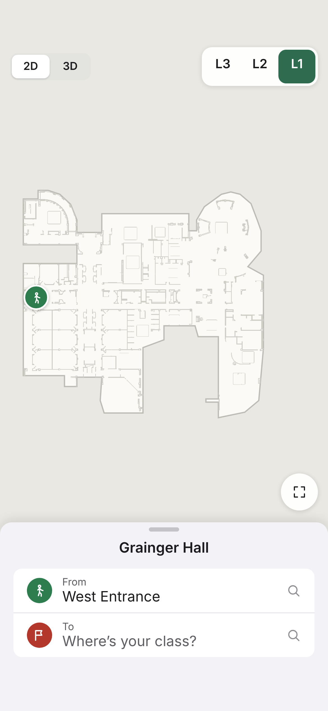
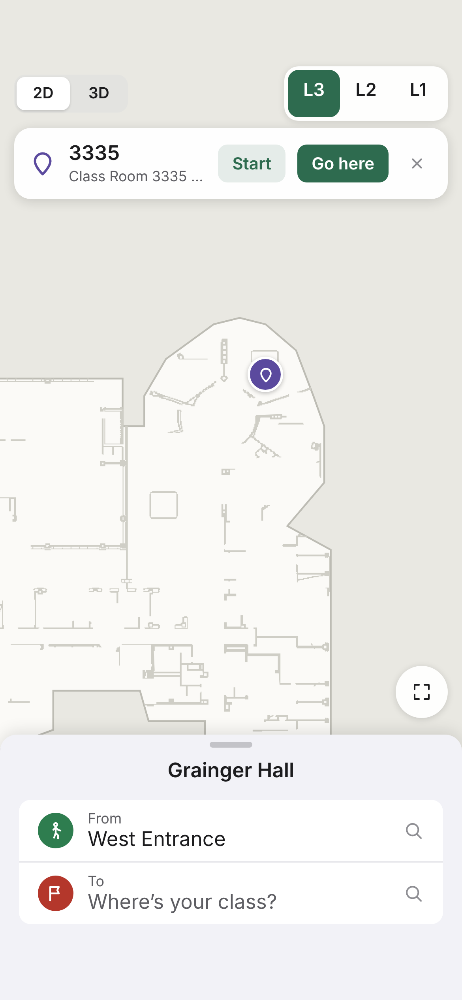
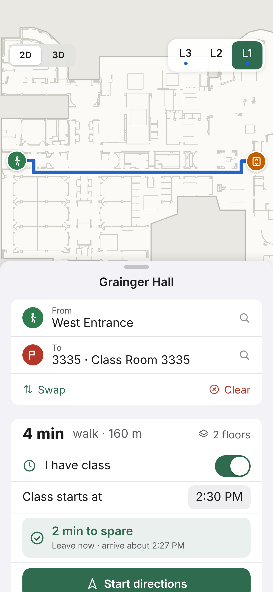
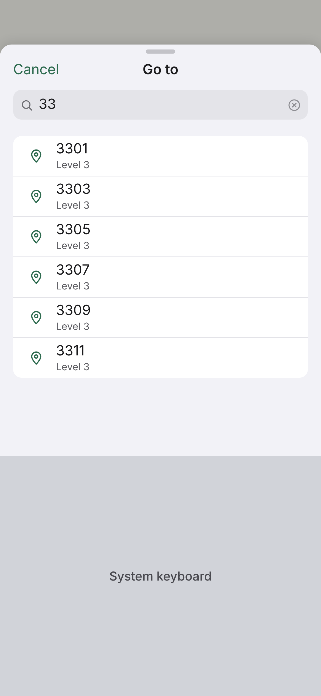
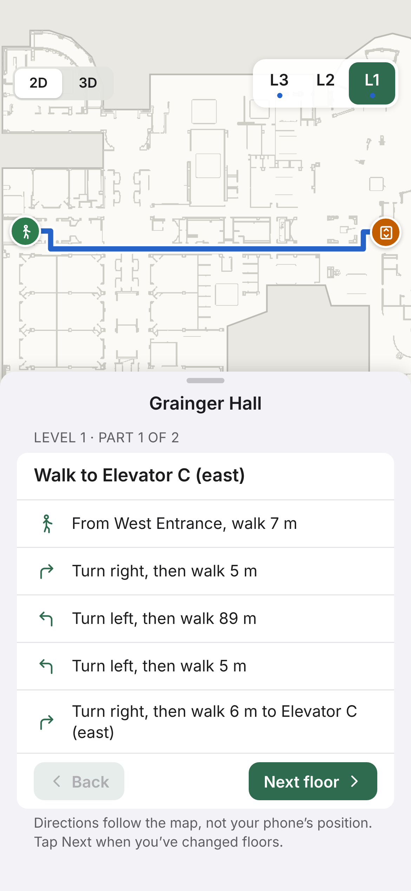
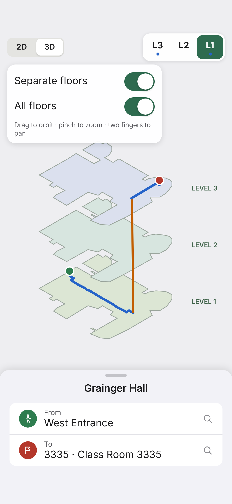
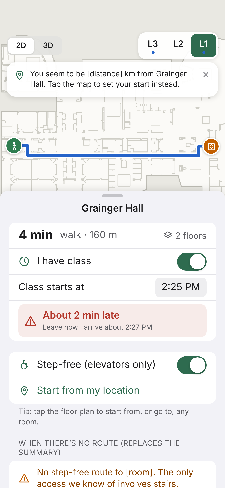

# TardyAI iOS wireframes

Wireframes for the UI pass on the SwiftUI app. The editable canvas is [TardyAI iOS Wireframes](https://claude.ai/artifact/6e5bbeBrV6SdD58Vj8ywMt). These PNGs are exported from it at iPhone size (390×844 pt, @3x).

**Flow:** Home → tap a room or search → route + "am I late?" card → step-by-step directions. The 3D view and the edge states come after.

All data is real: Grainger Hall, router output for West Entrance → 3335 (186 s, shown as "4 min"; 160 m; via Elevator C). The layout matches the app on `main`, so restyle freely, but keep the sheet-over-map structure. Values in `[brackets]` are filled in live.

| | | | |
|:-:|:-:|:-:|:-:|
|  |  |  |  |
| **1 · Home** | **2 · Tap a room** | **3 · Route + am-I-late** | **4 · Search** |
|  |  |  | |
| **5 · Directions** | **6 · 3D view** | **7 · Edge states** | |

## Screen notes

### 1 · Home: `ContentView`, `FloorPlanView`
- The map fills the screen. The route panel is a sheet the student can't dismiss, with three heights: peek, half and full.
- **Top bar:** a 2D/3D switch and a floor picker (L3/L2/L1). A blue dot under a floor means the route passes through it.
- **Start:** defaults to West Entrance, the only mapped entrance.
- **Map gestures:** pinch to zoom, drag to pan. The ⤢ button shows the whole floor.

### 2 · Tap a room: `AppModel.handleTap`, `TappedSpotCard`
- Tapping near a room label shows this card under the controls. It isn't a pop-up, because the sheet is already presented.
- **Start** routes from this room. **Go here** makes it the destination.
- Tapping a corridor still offers **Start**, using the nearest walkable point.

### 3 · Route: `RoutePanel`, `ArrivalCard`
- The map frames the current floor's part of the route automatically. The orange badge marks where you board the elevator.
- The class time is saved between launches. The verdict rechecks every 15 s; lateness rounds up and spare time rounds down.

### 4 · Search: `PlacePicker`
- Opens over the sheet when you tap From or To.
- **Ranking:** exact room number, then number prefix, then name, then aliases like "restroom" and "bathroom".
- **Empty query:** browse mode. Entrances and restrooms first, then every room by floor.
- Rooms without a name show just the number and the floor.

### 5 · Directions: `RoutePanel.activeLegSection`
- One floor ("part") at a time. The map switches to that floor and dims the other parts of the route.
- The router writes the steps; turns under 30° merge into one step.
- **Next floor**, **Back** and **Done** move between parts. The app never claims to track you indoors.

### 6 · 3D view: `Building3DView` (SceneKit)
- Shows the same route as 2D. Orange is the elevator ride between floors.
- **Floors:** built from the traced plan model, with each floor's plan image on its slab.
- **Toggles:**
  - Separate floors: 26 m gap. Stacked: 4.2 m.
  - All floors, or only the current floor.
- This wireframe's stack is schematic; the app renders the real geometry.

### 7 · Edge states
- **Late:** the verdict turns red with a warning icon.
- **GPS banner:** appears when the location fix is outside the building. After setting a start from GPS, it reminds you that GPS can't tell floors apart.
- **Step-free:** the toggle reroutes and can change the ETA.
- **No route:** a message replaces the summary and the directions.
